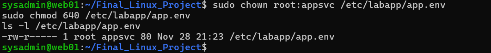
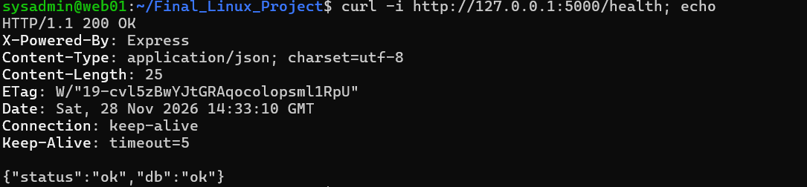
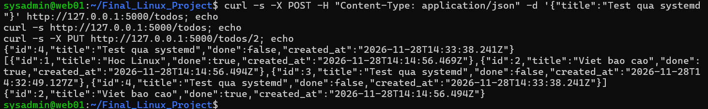
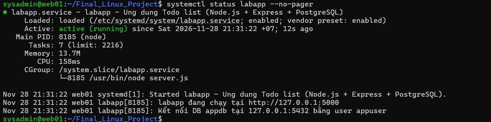
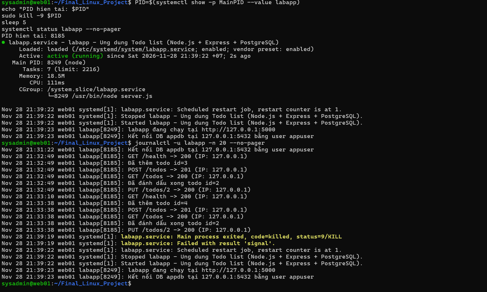
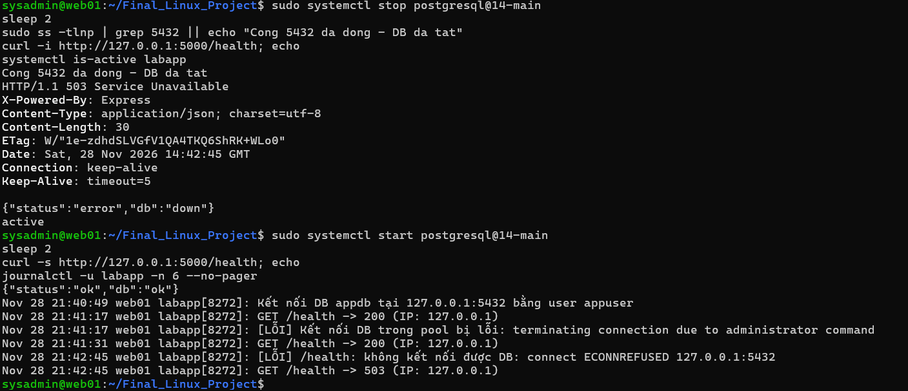
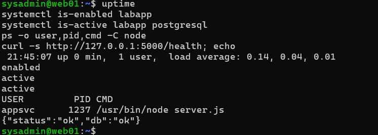
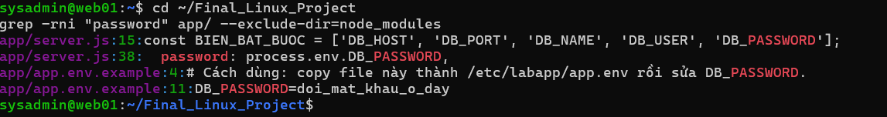

# Phần 3 — Ứng dụng & systemd

**Người phụ trách:** Nguyễn Trọng An (Người 3) — GitHub `nguyentrongan0912`
**File thật đã nộp:** `app/` (mã nguồn), `configs/systemd/labapp.service`, `app/app.env.example`, `app/init.sql`

## 1. Tổng quan

Ứng dụng Todo list viết bằng **Node.js 20 + Express + thư viện `pg`**, lưu dữ liệu trong PostgreSQL (DB `appdb`, role `appuser`). App chạy như dịch vụ systemd `labapp.service` bằng user hệ thống `appsvc`, chỉ nghe `127.0.0.1:5000`; người dùng truy cập qua Nginx (Người 2) tại `https://app.lab.local`.

Luồng xử lý: trình duyệt → Nginx (443) → `127.0.0.1:5000` (labapp, user `appsvc`) → PostgreSQL `127.0.0.1:5432` (role `appuser`) → trả JSON về trình duyệt.

| Thành phần | Giá trị |
|---|---|
| Hệ điều hành | Ubuntu 22.04.5 LTS (VM `web01`, 192.168.56.10) |
| Node.js | v20.20.2 (NodeSource), npm 10.8.2 |
| Thư viện | `express` ^4.21.2, `pg` ^8.13.1 (khóa phiên bản bằng `package-lock.json`) |
| Vị trí code khi chạy | `/opt/app` (chủ `root:root`, thư mục 755, file 644) |
| User chạy app | `appsvc` (user hệ thống, shell `/usr/sbin/nologin`, không có home) |
| Địa chỉ lắng nghe | `127.0.0.1:5000` |
| Service | `labapp.service` |
| File bí mật | `/etc/labapp/app.env` (chủ `root:appsvc`, quyền 640) |

### Các endpoint

| Endpoint | Loại | Chức năng | Mã trả về |
|---|---|---|---|
| `GET /health` | đọc | Kiểm tra app **và** kết nối DB (chạy `SELECT 1`) | 200 nếu tốt, 503 nếu DB chết |
| `GET /todos` | đọc | Lấy danh sách việc | 200 |
| `POST /todos` | ghi | Thêm việc, body `{"title": "..."}` (1–200 ký tự) | 201, hoặc 400 nếu dữ liệu sai |
| `PUT /todos/<id>` | ghi | Đánh dấu việc đã xong | 200, 400 nếu id sai, 404 nếu không có |
| `GET /` | đọc | Trang `public/index.html` (HTML/CSS/JS thuần, gọi API bằng `fetch()`) | 200 |

## 2. Các bước xây dựng (quyết định then chốt và lý do)

1. **Cài Node.js 20 LTS từ kho NodeSource**, không dùng `apt install nodejs` mặc định vì kho Ubuntu 22.04 chỉ có Node 12 (đã hết hỗ trợ). Lệnh: tải `https://deb.nodesource.com/setup_20.x`, chạy để thêm kho, rồi `apt install nodejs`.
2. **PostgreSQL tạm trên VM riêng** (đúng hợp đồng, để làm độc lập với Người 4): `createuser --pwprompt appuser` tạo role **không** superuser/createdb/createrole; `createdb appdb` do `postgres` làm chủ. Lúc ráp, Người 4 dựng lại với cùng tên nên app không phải sửa.
3. **Bảng và quyền bằng `init.sql`**: `CREATE TABLE IF NOT EXISTS` để chạy lại nhiều lần không lỗi. Chỉ cấp cho `appuser` quyền `CONNECT` vào `appdb`, `SELECT/INSERT/UPDATE` trên `todos` và quyền dùng sequence `todos_id_seq`; **không** cấp `DELETE`, `DROP` vì app không cần (đặc quyền tối thiểu).
4. **Cấu hình chỉ đọc từ biến môi trường** `DB_HOST DB_PORT DB_NAME DB_USER DB_PASSWORD`. Thiếu biến nào thì app ghi lỗi ra stderr và thoát mã 1 (để systemd/journald thấy rõ nguyên nhân). Không có mật khẩu nào trong mã nguồn.
5. **Kết nối DB qua pool** (`pg.Pool`, tối đa 5 kết nối, timeout 3 giây): tái sử dụng kết nối thay vì mở mới mỗi yêu cầu; khi DB khởi động lại, pool tự kết nối lại, lỗi kết nối được bắt bằng `pool.on('error')` nên app không sập.
6. **Câu SQL có tham số** (`$1`) thay vì ghép chuỗi → chống SQL injection. Dữ liệu đầu vào được kiểm tra (title 1–200 ký tự, id là số nguyên dương) trước khi chạm DB. Phía giao diện dùng `textContent` thay vì `innerHTML` để chữ người dùng nhập không thể chạy thành mã (chống XSS).
7. **App chỉ nghe `127.0.0.1`**, không nghe `0.0.0.0`: máy ngoài không gọi thẳng được app, bắt buộc đi qua Nginx (nơi có HTTPS và các lớp bảo vệ). Khi chưa có Nginx, kiểm tra giao diện bằng SSH tunnel `ssh -L 5000:127.0.0.1:5000 sysadmin@192.168.56.10`.
8. **User hệ thống `appsvc`** tạo bằng `useradd --system --no-create-home --shell /usr/sbin/nologin appsvc`. App không chạy bằng root nên nếu bị chiếm quyền, kẻ tấn công chỉ có quyền của `appsvc`.
9. **Code ở `/opt/app` thuộc `root:root`, `appsvc` chỉ đọc**: app (và kẻ chiếm được app) không sửa được mã nguồn của chính nó. Thư viện cài bằng `npm ci --omit=dev` để đúng y phiên bản trong `package-lock.json`.
10. **Bí mật ở `/etc/labapp/app.env`, quyền 640, chủ `root:appsvc`**: tách hẳn khỏi mã nguồn nên code đưa lên Git không kéo theo mật khẩu (`.gitignore` chặn thêm `app.env`, chỉ commit `app.env.example`).
11. **Unit `labapp.service`** dùng `User=appsvc`, `WorkingDirectory=/opt/app`, `EnvironmentFile=/etc/labapp/app.env`, `Restart=on-failure`, `RestartSec=3`, log ra journald; cài vào `/etc/systemd/system/`, `daemon-reload`, `enable --now`.

## 3. Bí mật và phân quyền

```
-rw-r----- 1 root appsvc ... /etc/labapp/app.env
```

| Ai | Quyền | Lý do |
|---|---|---|
| `root` (chủ) | `rw-` (6) | Chỉ quản trị viên được sửa cấu hình |
| nhóm `appsvc` | `r--` (4) | Tài khoản của app chỉ được đọc, không tự đổi cấu hình |
| người khác | `---` (0) | Không ai khác xem được mật khẩu DB |

Kiểm chứng: `cat /etc/labapp/app.env` bằng `sysadmin` (không sudo) → `Permission denied`; `sudo -u appsvc test -r /etc/labapp/app.env` → đọc được.

**Vì sao dùng `EnvironmentFile`:** mật khẩu không nằm trong code, cũng không nằm trong unit file (unit file ai cũng đọc được, và được nộp kèm báo cáo). Đổi mật khẩu chỉ cần sửa một file rồi `systemctl restart labapp`, không phải sửa code.



## 4. systemd: `labapp.service`

File thật: `configs/systemd/labapp.service`. Các dòng chính:

| Dòng | Ý nghĩa |
|---|---|
| `After=network.target postgresql.service` | Khởi động sau mạng và PostgreSQL |
| `Wants=postgresql.service` | Muốn có DB nhưng DB tắt thì app **không** bị tắt theo; `/health` sẽ báo 503 |
| `User=appsvc`, `Group=appsvc` | Chạy bằng user hệ thống, không dùng root |
| `WorkingDirectory=/opt/app` | Để `server.js` và `express.static('public')` tìm đúng thư mục |
| `EnvironmentFile=/etc/labapp/app.env` | Nạp biến môi trường chứa thông tin DB |
| `ExecStart=/usr/bin/node server.js` | Lệnh chạy app |
| `Restart=on-failure`, `RestartSec=3` | App chết bất thường → chờ 3 giây rồi bật lại |
| `StandardOutput/StandardError=journal`, `SyslogIdentifier=labapp` | `console.log`/`console.error` vào journald, xem bằng `journalctl -u labapp` |
| `NoNewPrivileges=true` | Tiến trình app không xin thêm quyền được |
| `WantedBy=multi-user.target` | `enable` → tự chạy khi khởi động máy |

**`Restart=on-failure` so với các lựa chọn khác:**
- `no`: chết là thôi, không bật lại.
- `on-failure` (đã chọn): bật lại khi app thoát với mã lỗi khác 0, bị giết bởi tín hiệu (vd `kill -9`), hoặc quá thời gian. **Không** bật lại khi admin chủ động `systemctl stop` hoặc app thoát bình thường (mã 0).
- `always`: luôn bật lại kể cả khi app thoát bình thường. Không chọn vì một lần app thoát có chủ ý cũng sẽ bị bật lại.

## 5. Kiểm thử và bằng chứng

| # | Kiểm thử | Lệnh | Kết quả |
|---|---|---|---|
| 1 | Health kiểm DB | `curl -i 127.0.0.1:5000/health` | `200 OK`, `{"status":"ok","db":"ok"}` |
| 2 | Đọc/ghi | `curl` POST, GET, PUT `/todos` | Thêm được (201), đọc được, `done:true` sau PUT |
| 3 | Dữ liệu sai | POST title rỗng; PUT `/todos/999` | 400 và 404, app không sập |
| 4 | `init.sql` chạy lại | chạy 2 lần | Lần 2: `already exists, skipping`, không `ERROR` |
| 5 | Service | `systemctl status labapp` | `enabled`, `active (running)` |
| 6 | User chạy app | `ps -o user,pid,cmd -C node` | `appsvc ... /usr/bin/node server.js` |
| 7 | Cổng lắng nghe | `ss -tlnp \| grep 5000` | chỉ `127.0.0.1:5000` |
| 8 | Kill app | `sudo kill -9 <PID>` | PID 8185 bị giết → 3 giây sau chạy lại với PID 8249 |
| 9 | Stop chủ động | `systemctl stop labapp`, chờ 5 giây | vẫn `inactive` (đúng `on-failure`) |
| 10 | DB chết | `systemctl stop postgresql@14-main` | `/health` → `503`, `{"db":"down"}`; app vẫn `active`; bật DB lại → `ok` |
| 11 | Reboot | `sudo reboot` | `up 0 min`, labapp `enabled` + `active`, `/health` ok |
| 12 | Không lộ mật khẩu | `grep -rni "password" app/ --exclude-dir=node_modules` | chỉ thấy tên biến `DB_PASSWORD` và mật khẩu giả trong `.example` |

**Health và CRUD:**





**Dịch vụ systemd active + enabled:**



**Kill tiến trình → systemd tự khởi động lại, thấy trong journalctl:**

Chuỗi sự kiện trong journal: `Main process exited, code=killed, status=9/KILL` → `Failed with result 'signal'` → `Scheduled restart job, restart counter is at 1` → `Started labapp` → app in lại dòng "đang chạy".



**`/health` thật sự kiểm tra DB:**

Lưu ý khi thử: trên Ubuntu, `postgresql.service` chỉ là service "tổng" điều khiển `postgresql@14-main` (tiến trình DB thật). Lệnh `systemctl stop postgresql` trả về trước khi DB tắt hẳn, nên lần thử đầu `/health` vẫn trả 200. Khi dừng thẳng `postgresql@14-main` thì thấy đúng 503 (`ECONNREFUSED 127.0.0.1:5432`).



**Reboot, app tự lên:**



**Không có mật khẩu hard-code:**



## 6. Cách tái tạo (trên VM1 `web01`)

```bash
# 1. Node.js 20
curl -fsSL https://deb.nodesource.com/setup_20.x -o nodesource_setup.sh
sudo -E bash nodesource_setup.sh && sudo apt install -y nodejs

# 2. Tạo bảng (DB appdb và role appuser do Người 4 tạo)
sudo -u postgres psql -d appdb < app/init.sql

# 3. User hệ thống và code
sudo useradd --system --no-create-home --shell /usr/sbin/nologin appsvc
sudo mkdir -p /opt/app
sudo rsync -a --exclude node_modules --exclude .gitignore --exclude .gitkeep app/ /opt/app/
cd /opt/app && sudo npm ci --omit=dev && cd -
sudo chown -R root:root /opt/app && sudo chmod -R u=rwX,go=rX /opt/app

# 4. File bí mật
sudo mkdir -p /etc/labapp
sudo cp app/app.env.example /etc/labapp/app.env   # rồi sửa DB_PASSWORD bằng sudo nano
sudo chown root:appsvc /etc/labapp/app.env && sudo chmod 640 /etc/labapp/app.env

# 5. Service
sudo cp configs/systemd/labapp.service /etc/systemd/system/
sudo systemctl daemon-reload && sudo systemctl enable --now labapp
curl 127.0.0.1:5000/health
```

## 7. Việc còn lại khi ráp (giai đoạn B)

- Chụp giao diện qua `https://app.lab.local` (sau khi Người 2 cấu hình Nginx).
- Xác nhận header `X-Real-IP` tới app: `journalctl -u labapp -f` phải thấy IP của máy truy cập thay vì `127.0.0.1`.
- Chạy lại toàn bộ bảng kiểm thử ở Mục 5 trên hệ thống đã ráp.
